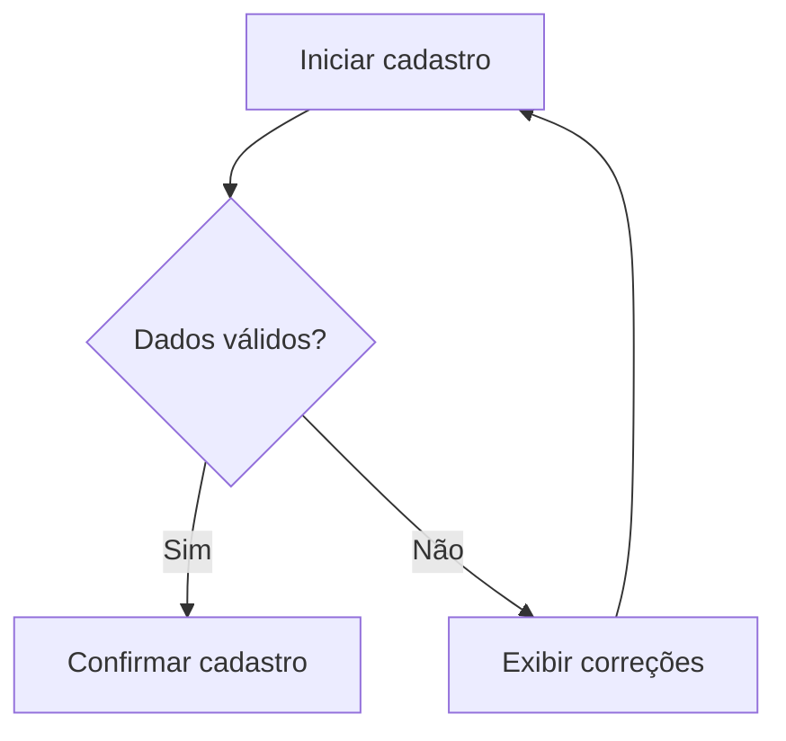

# Modelo de PRD

Preencher com informações conhecidas. Marcar `[Hipótese]` e `[Pendente]`. Omitir seções não aplicáveis.

1. **Visão geral:** produto, problema, objetivo, versão.
2. **Contexto e evidências:** pesquisas, dados e fontes; nível de confiança.
3. **Público e personas:** necessidades, situações de uso, atores e permissões.
4. **Proposta de valor:** benefício e diferencial a validar.
5. **Objetivos e métricas:** resultado esperado e como medi-lo.
6. **Escopo MVP:** incluído, excluído e futuro; justificativa de prioridade.
7. **Jornadas e fluxos:** passos, decisões, exceções; Mermaid quando útil.
8. **Telas e navegação:** finalidade, componentes, ação principal, estados.
9. **Requisitos funcionais:** ID, descrição, prioridade, dependências.
10. **Histórias de usuário:** Como [ator], quero [capacidade], para [resultado].
11. **Critérios de aceite:** preferir Dado/Quando/Então, com resultados verificáveis.
12. **Regras de negócio:** validações, cálculos e exceções.
13. **Dados e integrações:** entidades, campos, serviços e autorizações.
14. **Não funcionais:** segurança, privacidade, acessibilidade, responsividade.
15. **Riscos, decisões e questões pendentes.**

## Exemplo Mermaid

Verificar que o diagrama corresponde ao texto e que suas decisões são legíveis.
