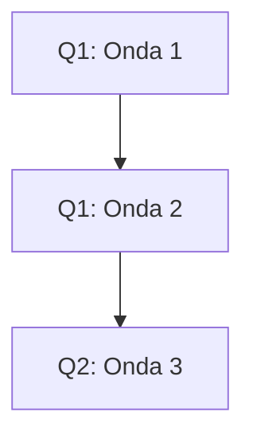

# Formato de apresentação

## Classificação dos épicos

| Épico | VU | VN | ET | Confiança | Dependências | Justificativa |
|---|---:|---:|---:|---|---|---|
| E01: [nome] | 3 | 2 | 1 | Verde | Nenhuma | [base da nota] |

## Matriz de confiança

| Épico | Nível | Evidências | Incertezas a reduzir |
|---|---|---|---|
| E01 | Médio (Amarelo) | [evidências reais] | [lacunas] |

## Ondas de entrega

| Onda | Épicos | Soma VU | Soma VN | Soma ET | Confiança | Por que nesta ordem? |
|---|---|---:|---:|---:|---|---|
| 1 | E01, E02 | 5 | 4 | 3 | Verde, Amarelo | [justificativa] |

## Roadmap trimestral

| Quarter | Onda | Épicos | Duração estimada | Premissas de capacidade | Riscos |
|---|---|---|---|---|---|
| Q1/2027 | 1 | E01, E02 | 6 semanas | [capacidade] | [riscos] |

Se couberem múltiplas ondas sequenciais no mesmo quarter, criar linhas separadas para cada uma. Nunca representar sobreposição ou onda cruzando quarters.

### Visual opcional Mermaid

Quando a sequência ficar mais fácil de entender visualmente, mostrar diagrama compacto com ondas e quarters, por exemplo:

Os nomes e tempos do exemplo são ilustrativos; substituir por dados reais. Não inventar datas exatas na ausência de calendário definido.
