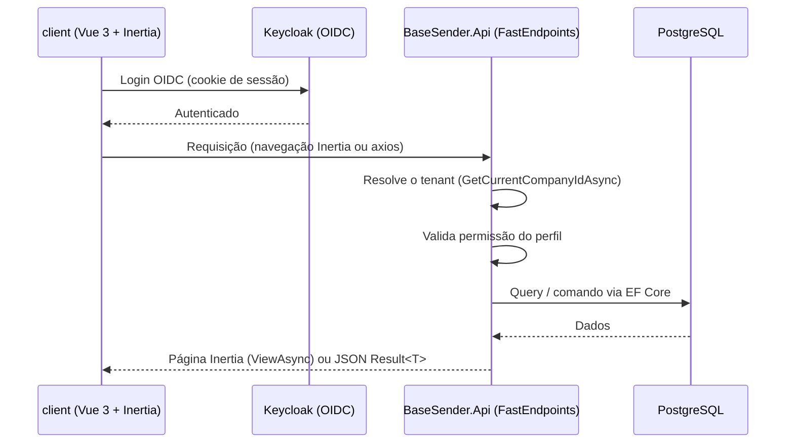

# 📋 Template de Especificação Técnica (Spec)

**Versão:** [1.0.0]  
**Domínio:** [Área de Negócio — ex: WABAs / Números / Acesso / Estrutura]  
**Status:** [Pendente / Em Desenvolvimento / Implementado]

---

## 1. Visão Geral
[Forneça um breve resumo do objetivo técnico da funcionalidade. Descreva qual problema de engenharia ela resolve e qual o impacto no sistema.]

---

## 2. Arquitetura e Fluxo de Dados

[Descreva como os dados trafegam entre o frontend Inertia, a API e o banco. Inclua diagramas de sequência Mermaid se aplicável — o GitHub renderiza Mermaid nativamente.]



Se a feature envolver integrações externas, acrescente as raias correspondentes — **Meta** (dona da WABA), **Pontal** (BSP) e **Sisbratel** (fornecedora de números) — deixando claro o que é responsabilidade de cada uma e o que o Base Sender apenas sincroniza.

---

## 3. Definição de Endpoints e Contratos

O Base Sender tem dois tipos de endpoint. Especifique a que tipo cada um pertence.

### 3.1. Endpoints de página (resposta Inertia)
Renderizam uma tela Vue via `ViewAsync("NomeDaPagina", props)`. Rota sem prefixo `/api`.

*   `[GET] /wabas`
    *   *Descrição*: [O que faz]
    *   *Página Vue*: `Pages/WabaList.vue`
    *   *Props enviadas* (serializadas em camelCase):
        ```json
        {
          "wabas": [
            { "id": "12565849879122", "wabaId": 1, "name": "WABA 1", "status": "Conectado" }
          ]
        }
        ```

### 3.2. Endpoints de dados (resposta JSON)
Recebem dados das telas. Rota com prefixo `/api`. Sempre retornam `Result<T>`.

*   `[POST] /api/{recurso}`
    *   *Descrição*: [O que faz]
    *   *Request Body*:
        ```json
        {
          "nome": "string",
          "numero": "string"
        }
        ```
    *   *Retorno (201 Created)*:
        ```json
        {
          "isSuccess": true,
          "value": { "id": 1, "nome": "string" },
          "error": null
        }
        ```
    *   *Retorno de erro (400 / 404 / 429)*:
        ```json
        {
          "isSuccess": false,
          "value": null,
          "error": "Mensagem de negócio em pt-BR"
        }
        ```
    *   *Validação*: campos validados por `Validator<T>` (FluentValidation); erros de campo voltam em `errors` e são aplicados na tela por `applyFieldErrors`.

---

## 4. Regras de Negócio Críticas (Specs)

| ID | Regra de Negócio | Detalhamento Técnico / Validação |
| :--- | :--- | :--- |
| **RN01** | **[Título da Regra]** | [Onde a regra é validada — Validator, endpoint ou índice do banco — e qual a consequência.] |
| **RN02** | **[Perfil e permissão]** | [Qual perfil pode executar; a checagem é feita no backend, não só ocultando o elemento na tela.] |
| **RN03** | **[Isolamento multi-tenant]** | [Como a query garante que um tenant não alcança dado de outro.] |

---

## 5. Esquema de Dados e Persistência

### 5.1. Migration (dbmate)
O projeto **não usa EF Migrations**. Toda alteração de esquema é um arquivo SQL em `database/migrations/{timestamp}_{nome}.sql`:

```sql
-- migrate:up

CREATE TABLE {tabela} (
    id BIGINT GENERATED ALWAYS AS IDENTITY PRIMARY KEY,
    {campo} VARCHAR(255) NOT NULL,
    company_id BIGINT NOT NULL REFERENCES company (id) ON DELETE CASCADE,
    is_active BOOLEAN NOT NULL DEFAULT true,
    is_removed BOOLEAN NOT NULL DEFAULT false,
    created_by BIGINT NOT NULL,
    updated_by BIGINT NULL,
    removed_by BIGINT NULL,
    created_at TIMESTAMPTZ NOT NULL DEFAULT now(),
    updated_at TIMESTAMPTZ NULL,
    removed_at TIMESTAMPTZ NULL
);

CREATE UNIQUE INDEX {tabela}_{campo}_unique_idx ON {tabela} ({campo}) WHERE is_removed = false;

-- migrate:down

DROP TABLE IF EXISTS {tabela};
```

### 5.2. Entidade e mapeamento EF
*   **Entidade** `src/BaseSender.Domain/Entities/{Entidade}.cs` — herda `BaseEntity`.
*   **Configuração** `src/BaseSender.Api/Infra/Configurations/{Entidade}Configuration.cs` — `ToTable`, colunas em snake_case, índices únicos filtrados por `is_removed = false`.
*   **DbSet** registrado em `src/BaseSender.Api/Infra/AppDbContext.cs`.

---

## 6. Cenários de Homologação e Critérios de Aceite (BDD)

### Cenário 01: [Título do Cenário]
*   **Dado** [Contexto ou pré-condição inicial]
*   **Quando** [Ação do usuário ou disparo do evento]
*   **Então** [Resultado final observado no frontend]
*   **E** [Mudança de estado persistido no banco de dados]

### Cenário 02: [Isolamento entre empresas]
*   **Dado** um registro pertencente a outra empresa
*   **Quando** o usuário chama o endpoint com o id desse registro
*   **Então** a API responde 404, sem revelar a existência do registro
